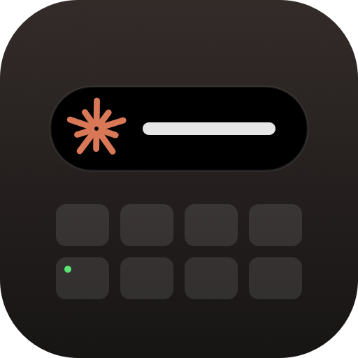

# claude-notch-notify

**Get a visible alert on your MacBook when Claude Code finishes a reply: your keyboard flashes
and a little pop-up grows out of the notch.**


Stop staring at the terminal while Claude works. Go do something else, and your Mac will let you
know when it's done (or when it needs your approval).

- ⌨️ **`kbflash`** flashes the **keyboard backlight** and the **green caps lock LED** together
- 🟠 **`notchpop`** grows a black pop-up out of the **notch** with a pulsing orange spark and a message
- 🔁 Restores your original brightness, auto-brightness and caps lock light afterwards
- 🔒 Caps lock light blinks **without** turning caps lock on
- 👆 **Click the pop-up** to jump straight back to Claude (or your terminal / VS Code). Hover to keep it open
- 🔔 Optional **sound** using any built-in macOS alert sound
- ⚙️ **Settings** for messages, flash counts, pop-up time and sound, with no file editing for plugin users
- 🙈 The pop-up never steals focus and has no Dock icon
- ⚡ Tiny native binaries, no dependencies, ~3 seconds per alert
- 🪝 Plugs straight into [Claude Code hooks](https://code.claude.com/docs/en/hooks)

## Install

Pick **one** of these. Each sets up the same alerts, so don't use more than one or you'll get double alerts.

### Option 1: Claude Code plugin

**Terminal or VS Code:** inside Claude Code, run:

```
/plugin marketplace add eliwhi/claude-notch-notify
/plugin install notch-notify@notch-notify
```

That's it. The hooks set themselves up. Remove it any time from `/plugin`.

**From your shell** (if you have the `claude` command installed):

```bash
claude plugin install notch-notify --marketplace eliwhi/claude-notch-notify
```

**Claude desktop app (Code tab):** typing `/plugin` there opens the app's plugin browser, which ignores
`marketplace add` and doesn't list third-party marketplaces. Use **Option 2** below instead. It works with
the desktop app, the terminal, and VS Code. Plugins installed from your shell also work in the desktop app.

### Option 2: One-line installer

```bash
curl -fsSL https://raw.githubusercontent.com/eliwhi/claude-notch-notify/main/install.sh | bash
```

This downloads the prebuilt programs into `~/.claude/bin/` and adds the hooks to
`~/.claude/settings.json`. Your existing settings are kept, a backup is saved to `settings.json.bak`,
and running it again won't add duplicates. Add `-s -- --no-hooks` after `bash` to install only the programs.

To uninstall:

```bash
curl -fsSL https://raw.githubusercontent.com/eliwhi/claude-notch-notify/main/uninstall.sh | bash
```

### Option 3: Build from source

Needs Xcode Command Line Tools (`xcode-select --install`).

```bash
git clone https://github.com/eliwhi/claude-notch-notify.git
cd claude-notch-notify
./scripts/build.sh   # compiles into dist/
./install.sh         # installs from dist/ and adds the hooks
```

After installing, **start a new Claude Code session** so it picks up the hooks.

## What you get

| Hook | When it fires | Alert |
| --- | --- | --- |
| `Stop` | Claude finished responding | "Claude is done" pop-up + 2 backlight flashes + 5 caps lock flashes |
| `Notification` | Claude is waiting on you (e.g. a permission prompt) | "Needs you" pop-up + 2 flashes of both lights |

## Settings

| Setting | Default | What it does |
| --- | --- | --- |
| Done message | `Claude is done` | Text in the notch when Claude finishes |
| Needs-you message | `Needs you` | Text in the notch when Claude is waiting for you |
| Keyboard backlight flashes | `2` | Backlight flashes when Claude finishes (`0` turns it off) |
| Caps lock light flashes | `5` | Caps lock light flashes when Claude finishes (`0` turns it off) |
| Pop-up seconds | `3` | How long the pop-up stays open |
| Show notch pop-up | on | Turn off to only flash the keyboard |
| Sound | `none` | A macOS sound to play: `Glass`, `Ping`, `Pop`, `Purr`, `Tink`, `Hero`, `Funk`, `Submarine`, and more |

**Plugin users:** run `/plugin`, open **notch-notify** on the **Installed** tab, and choose **Configure options**.
The settings also appear in `/config`.

**Installer users:** add any of these to the `env` section of `~/.claude/settings.json`:

```json
{
  "env": {
    "NOTCH_DONE_MESSAGE": "All done!",
    "NOTCH_NEEDS_YOU_MESSAGE": "Your turn",
    "NOTCH_BACKLIGHT_FLASHES": "2",
    "NOTCH_CAPS_FLASHES": "5",
    "NOTCH_POPUP_SECONDS": "3",
    "NOTCH_SHOW_POPUP": "true",
    "NOTCH_SOUND": "Glass"
  }
}
```

Start a new Claude Code session after changing settings.

## Requirements

- A MacBook with a backlit keyboard, macOS 13 or later (tested on an M5 MacBook Pro, macOS 26)
- A notch for the full pop-up effect (without one it shows as a small tab at the top of the screen)
- [Claude Code](https://claude.com/claude-code) (terminal, VS Code extension, or the desktop app's Code tab)
- The prebuilt programs are universal (Apple Silicon + Intel). They're tested on Apple Silicon only

## Usage

### kbflash

```bash
kbflash [backlight_flashes] [caps_flashes] [on_ms] [off_ms]
```

| Argument | Default | Meaning |
| --- | --- | --- |
| `backlight_flashes` | `2` | Blinks of the keyboard backlight |
| `caps_flashes` | `5` | Blinks of the green caps lock light |
| `on_ms` | `400` | Milliseconds lit |
| `off_ms` | `250` | Milliseconds dark |

```bash
kbflash                   # backlight x2, caps lock x5, 400 ms on, 250 ms off
kbflash 5 5               # both lights 5 times
kbflash 0 5               # caps lock light only
kbflash 3 3 150 150       # 3 fast blinks of both
kbflash 8 8 600 400       # slow and obvious
KBFLASH_DEBUG=1 kbflash   # print what it's doing
```

### notchpop

```bash
notchpop [message] [seconds]
```

| Argument | Default | Meaning |
| --- | --- | --- |
| `message` | `Done` | Text shown to the right of the notch |
| `seconds` | `3` | How long it stays open (longer while you hover over it) |

```bash
notchpop                          # "Done" for 3 seconds
notchpop "Tests passed" 5         # any message you like
NOTCHPOP_DEBUG=1 notchpop         # print which app a click will open
```

Clicking the pop-up opens the app it was launched from, such as Claude, Terminal, iTerm or VS Code.

### notch-alert

The command the hooks run. It reads the settings above and runs the pop-up, keyboard flash and sound together.

```bash
notch-alert done        # Claude finished
notch-alert needs-you   # Claude is waiting for you
```

## How it works

- **Backlight:** Apple's private `CoreBrightness` framework (`KeyboardBrightnessClient`), the same
  API Control Centre uses. Brightness changes are applied instantly and aren't saved as your preference.
  Auto-brightness is paused during the flash so it doesn't fight back.
- **Caps lock LED:** IOKit HID. The program writes the keyboard's LED output element directly, which
  lights the LED without changing the actual caps lock state.
- **Notch pop-up:** a borderless AppKit panel at screen-saver level, so it sits above the menu bar.
  It reads the notch's exact size from `NSScreen` (`safeAreaInsets` and the auxiliary top areas), starts
  as a black shape covering the notch, springs outwards into "ears" on each side, then shrinks back and exits.
  To make clicks work, it walks up its parent processes when it starts and remembers the first real app
  (the one that launched Claude Code). A click reopens that app with `NSWorkspace`.

## What the plugin does on your Mac

Everything the plugin runs, so you can see exactly what you're installing:

- **When it runs:** only on Claude Code's `Stop` event (Claude finished a reply) and `Notification` event
  (Claude is waiting for you). Each run lasts about 3 seconds and then exits. Nothing stays running in the background.
- **What it runs:** the `notch-alert` shell script, which starts `notchpop` (the pop-up) and `kbflash`
  (the keyboard flash), and plays a built-in macOS sound with `afplay` if you turned sound on.
- **What it changes:** the keyboard backlight level and the caps lock LED while flashing. Both are put back
  as they were afterwards. Nothing is saved as a preference.
- **What it reads:** the screen's notch size, your current keyboard brightness and caps lock LED state,
  and the list of parent processes (to know which app a click should open). It reads nothing from your
  conversations, files or Claude Code session.
- **Network and data:** none. The plugin makes no network requests and sends no data anywhere.
- **Clicks:** clicking the pop-up opens the app that launched Claude Code, such as Claude, Terminal or VS Code.
- **Settings:** the plugin doesn't change your Claude Code settings or permissions. It only reads its own
  options. (The separate one-line installer adds two hooks to `~/.claude/settings.json`. See Option 2.)

### About the prebuilt programs

`dist/kbflash` and `dist/notchpop` are compiled from the readable source in `src/` by `scripts/build.sh`.
They're universal (Apple Silicon + Intel) and ad-hoc signed. To check them yourself, rebuild from
source with `./scripts/build.sh` and compare. `dist/notch-alert` is a plain shell script, the same file as
`src/notch-alert.sh`.

## Caveats

- `CoreBrightness` is a private framework. It works on current macOS, but Apple could change it.
- The keyboard flash is hard to see in a bright room.
- The MacBook backlight is one zone, so per-key effects (ripples, single rows) aren't possible.
- The orange spark is an original drawing, not an official Anthropic logo.

## Uninstall

- **Plugin:** remove it from `/plugin` in Claude Code
- **Installer:** run the uninstall one-liner above. It removes the programs and only its own hooks

## Privacy

notch-notify collects nothing and makes no network requests. See [PRIVACY.md](PRIVACY.md).

## Support

Found a bug or have an idea? [Open an issue](https://github.com/eliwhi/claude-notch-notify/issues).

## License

[MIT](LICENSE)
